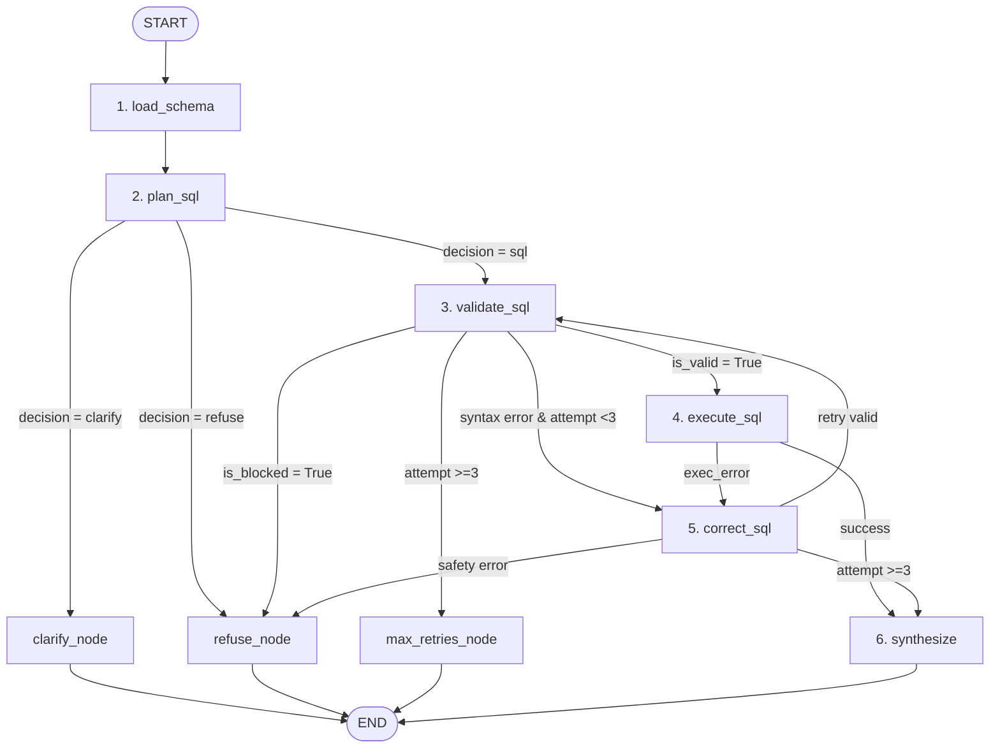

# NL-to-SQL Agent — End-to-End Interview Preparation Guide

This document is a comprehensive, production-level guide covering the architecture, implementation choices, safety model, benchmarking, and design trade-offs of this NL-to-SQL agent.

---

## 1. 30-Second Elevator Pitch

> *"I built a production-grade Natural Language to SQL agent for an e-commerce platform using **LangGraph**, **Groq (Llama 3.3 70B & 8B)**, and **PostgreSQL**. Instead of a generic prompt-to-database script, it is built as a state machine featuring **DIN-SQL Chain-of-Thought planning**, a **7-layer defense-in-depth safety architecture** with AST parsing via `sqlglot`, **dynamic schema profiling with hash-based caching**, an **error-classified self-correction loop**, and **end-to-end tracing via Langfuse**. On warm cache, our framework and database overhead is under **15 milliseconds**, with zero-cost deterministic synthesis for tabular data."*

---

## 2. Technology Stack & Key Libraries

| Component | Technology | Rationale / Interview Defense |
| :--- | :--- | :--- |
| **Orchestration** | [LangGraph](file:///Users/hiteshprajapathi/Desktop/nl2sql-agent/src/nl2sql/agent/graph.py) | Cyclic state machine allows explicit control over early terminal exits (security refusals), clarification routing, and bounded retry loops. |
| **LLMs** | **Groq**: Llama 3.3 70B (Planner & Correction), Llama 3.1 8B (Synthesis) | Ultra-low latency via LPUs; 70B handles complex multi-table SQL joins and schema linking; 8B handles fast summarization. |
| **Database** | PostgreSQL 16 (Docker) + `asyncpg` | Production-grade relational DB with connection pooling, native read-only transactions, and strict connection timeouts. |
| **SQL AST Engine** | `sqlglot` | Full abstract syntax tree parser (Postgres dialect) to block non-SELECT queries, CTE injection, and dangerous functions. |
| **API & Server** | FastAPI + Uvicorn | Async HTTP endpoints (`/query`, `/health`), static web UI mounting, session management. |
| **Observability** | Langfuse + `structlog` | Open-source LLM observability tracking token usage, latency per node, AST validation verdicts, and conversation threads. |
| **Package Tooling** | `uv` | Fast Python package manager for reproducible lockfiles and instant virtualenv sync. |

---

## 3. LangGraph Topology & State Machine

The graph is compiled in [src/nl2sql/agent/graph.py](file:///Users/hiteshprajapathi/Desktop/nl2sql-agent/src/nl2sql/agent/graph.py). It operates as a 6-node state machine with strict branching:



### Detailed Node Breakdown

### Node 1: `load_schema` ([plan.py](file:///Users/hiteshprajapathi/Desktop/nl2sql-agent/src/nl2sql/agent/nodes/plan.py#L21-L37))
- Calls `FullSchemaProvider.get_context()`.
- Calculates an MD5 hash of `information_schema.columns` via `get_catalog_hash`.
- If hash matches, returns cached context in **~1–3 ms** (vs 69 ms on cold cache).
- Injects: table names, column types, PKs, FKs, CHECK constraints, row counts, low-cardinality distinct values ($\le 30$), min/max date ranges, and 3 sample rows per table.

### Node 2: `plan_sql` ([plan.py](file:///Users/hiteshprajapathi/Desktop/nl2sql-agent/src/nl2sql/agent/nodes/plan.py#L39-L124))
- **Fast-path guard**: Checks regex patterns for jailbreaks/prompt injection (`detect_prompt_injection`) *before* spending an LLM API call.
- **Merged Single-Pass Planner**: Uses Groq Llama 3.3 70B with Pydantic structured output (`PlanResult`, `method="json_mode"`). Instead of separate intent classification and SQL generation calls, one call outputs intent (`sql`, `clarify`, or `refuse`), assumptions, and SQL.
- **DIN-SQL Chain-of-Thought**: Enforces structured reasoning in Pydantic: `relevant_tables` → `ambiguity_analysis` → `decision` & `sql`.

### Node 3: `validate_sql` ([execute.py](file:///Users/hiteshprajapathi/Desktop/nl2sql-agent/src/nl2sql/agent/nodes/execute.py#L20-L43))
- Synchronous AST inspection using `sqlglot` (takes **1–4 ms**).
- Enforces single-statement SELECTs, CTE cleanliness, and blocks dangerous PG functions.
- **Critical Security Invariant**: If `is_blocked=True` (safety violation), it triggers a **terminal exit to END**. It is **never** retried or corrected via LLM (prevents attackers from iteratively bypassing safety).

### Node 4: `execute_sql` ([execute.py](file:///Users/hiteshprajapathi/Desktop/nl2sql-agent/src/nl2sql/agent/nodes/execute.py#L47-L72))
- Executes query via `asyncpg` within `conn.transaction(readonly=True)`.
- Fetches `ROW_CAP + 1` (501 rows) to detect result truncation without loading unbounded rows into memory. Takes **~1–2 ms**.

### Node 5: `correct_sql` ([execute.py](file:///Users/hiteshprajapathi/Desktop/nl2sql-agent/src/nl2sql/agent/nodes/execute.py#L104-L179))
- Error-classified self-correction loop (max 3 attempts).
- Classifies errors into:
  - `SAFETY`: Terminal block.
  - `TIMEOUT`: Injects specific instruction: *"Query timed out. Reduce JOINs, add LIMIT, or narrow date range."*
  - `SYNTAX`: Injects failed query + PG error message + schema context.
- Loops back to `validate_sql` to verify that the repaired query is safe.

### Node 6: `synthesize` ([synthesize.py](file:///Users/hiteshprajapathi/Desktop/nl2sql-agent/src/nl2sql/agent/nodes/synthesize.py#L19-L90))
- **Hybrid synthesis**:
  - Empty result → Explains no rows matched and highlights the data date range (**2026-01-01 to 2026-06-30**).
  - Single scalar → Formats as bold value (`**42**`).
  - $\le 10$ rows → Deterministic Markdown table generator (**0.0 ms, zero LLM cost!**).
  - $> 10$ rows → Invokes fast 8B model (`llama-3.1-8b-instant`) to summarize key findings in 2–4 sentences.

---

## 4. The 7-Layer Defense-in-Depth Safety Model

| Layer | Mechanism | Implementation Detail |
| :---: | :--- | :--- |
| **1** | **Postgres User Roles** | Connected via dedicated `nl2sql_reader` role. Only has `GRANT SELECT ON ALL TABLES`. Even if every layer above fails, Postgres physically rejects writes. |
| **2** | **Read-Only Transactions** | Every query runs wrapped in `asyncpg.connection.transaction(readonly=True)` and session-level `default_transaction_read_only = on`. |
| **3** | **Strict Resource Quotas** | `statement_timeout = 15000` (15s), `lock_timeout = 5000` (5s), `idle_in_transaction_session_timeout = 30000`, hard row cap at 500 rows. |
| **4** | **AST Validation (`sqlglot`)** | Parses query tree. Enforces single statement, root `SELECT` or `WITH ... SELECT`, no DML/DDL inside CTEs, blocks `SELECT ... INTO`, `FOR UPDATE`, blocks dangerous functions (`pg_sleep`, `pg_read_file`, `dblink`, etc.), and blocks system schemas (`pg_catalog`, `information_schema`). |
| **5** | **Prompt-Injection Guards** | Regex filters (`detect_prompt_injection`) run before LLM execution for jailbreaks like `"ignore previous instructions"`, `"DAN mode"`, `"you are now"`. |
| **6** | **Data Isolation** | Data passed to synthesis LLM is wrapped in strict delimiters (`---DATA---`) to avoid indirect prompt injection from malicious DB content. |
| **7** | **Terminal Refusal & Auditing** | Security violations are terminal (no error loop). Full telemetry pushed to Langfuse and logged via structured JSON (`structlog`). |

---

## 5. Schema Profiling vs. Simple DDL Dumps

**Why DDL dumps fail in real-world Text-to-SQL:**
1. **Value Grounding:** If a user asks for *"Silver tier customers"*, an LLM might guess `'silver'`, `'SILVER'`, or `'tier_2'`. Our `introspect_schema` checks `information_schema` and queries distinct values for low-cardinality columns ($\le 30$ distinct values). It injects:
   `Distinct values: ['Basic', 'Gold', 'Silver']`. The LLM never hallucinates enum values.
2. **Date Boundaries (Time Anchoring):** The test data only covers **2026-01-01 to 2026-06-30**. We profile the min/max dates so the LLM doesn't query for "today's orders" and return empty sets without explanation.
3. **Foreign Key Graph:** Explicitly maps relationships (`orders.customer_id → customers.customer_id`), preventing the LLM from making hallucinated join paths.
4. **Change-Based Caching:** We hash the catalog using:
   `SELECT md5(string_agg(table_name || column_name || data_type ...))`. Cache invalidation happens when the database DDL actually changes, not on an arbitrary timer.

---

## 6. DIN-SQL & Left-to-Right Chain-of-Thought

**Prompt Engineering Design:**
We adapted the **DIN-SQL** paradigm (*Pourreza & Rafiei, NeurIPS 2023*):
- Autoregressive LLMs generate tokens **left-to-right**. If you ask an LLM to generate SQL first, it commits to a query before thinking about table joins or ambiguities.
- In `PlanResult` ([models.py](file:///Users/hiteshprajapathi/Desktop/nl2sql-agent/src/nl2sql/models.py#L9-L50)), the JSON fields are strictly ordered:
  1. `relevant_tables`: Identifies required tables and validates FK paths.
  2. `ambiguity_analysis`: Explicitly checks for column name collisions, nullable FKs, or duplicate names.
  3. `decision` & `sql`: Generated **only after** steps 1 and 2 are committed into the LLM context window.
- **Zero-Shot Adaptation**: We dropped few-shot examples because our dynamic schema profiling (sample rows + distinct values) provides better context while saving ~40% of the prompt token budget.

---

## 7. The 8 Domain Trap Doors in the Benchmark

The `benchmarks/golden_set.py` suite contains 8 tricky database traps:

1. **Trap 1: Revenue Ambiguity**: `orders.total_amount` (order-line total at checkout) $\neq$ `payments.amount` (settled cash) $\neq$ Net Revenue (payments minus refunds). The agent either clarifies or explicitly states its assumption.
2. **Trap 2: `payment_id != order_id`**: `refunds` joins `payments(payment_id)`, NOT `orders(order_id)`. Direct join on order_id is a bug.
3. **Trap 3: Agent vs Customer Collision**: *Priya Verma* exists as both a customer (`customer_id=3`) and a support agent (`agent_id=1`).
4. **Trap 4: Cancelled Orders with Completed Payments**: Orders marked `cancelled` where money was collected but never refunded.
5. **Trap 5: Partial Payments**: `orders.total_amount` is greater than the sum of completed payments.
6. **Trap 6: Ticket/Order Mismatch**: A customer created a support ticket referencing an order belonging to another customer (`support_tickets.customer_id != orders.customer_id`).
7. **Trap 7: Name Collision**: Two distinct customers share the name *Rahul Menon* (`customer_id=10` and `customer_id=12`). When asked *"Show orders for Rahul Menon"*, the agent triggers `clarify`.
8. **Trap 8: Time Anchoring**: Data only exists from Jan–Jun 2026. Queries for "last month" must account for the static snapshot window.

---

## 8. Latency Numbers & Profiling

From our latency benchmark ([WRITEUP.md](file:///Users/hiteshprajapathi/Desktop/nl2sql-agent/WRITEUP.md#L35-L58)):
```text
[LAT-01] How many customers are there in each tier?
  run 1: 1112ms total
  nodes: load_schema:  69ms (cold) / 3ms (warm)
         plan_sql:    939ms
         validate_sql:  4ms
         execute_sql:   1ms
         synthesize:    0ms
```
- **Framework + DB Overhead:** $< 15\text{ ms}$.
- **LLM Inference:** Accounts for $>95\%$ of total request latency.
- **Production Optimizations:**
  1. **Prompt Caching**: Groq/Anthropic cache system prompts; since the schema string is identical across requests, TTFT drops by up to 80%.
  2. **Model Tiering**: Use 70B (or Claude 3.5 Sonnet) only for planning/SQL; use 8B (or Haiku) for error correction and synthesis.

---

## 9. Multi-turn Memory

- Maintained in an in-memory session store keyed by `thread_id`.
- The last 4 conversation turns (User Question, Decision, SQL Executed, Final Answer) are formatted into the prompt's `followup_block`.
- Resolves pronoun references naturally (e.g., *"Which of those are still open?"* or *"Now show just the cancelled ones"*).

---

## 10. Scaling to 200+ Tables (System Design)

1. **Retrieval-Augmented Schema (RAS):**
   - The code defines an abstract base class `SchemaProvider` ([provider.py](file:///Users/hiteshprajapathi/Desktop/nl2sql-agent/src/nl2sql/schema/provider.py)). We can replace `FullSchemaProvider` with `RetrievalSchemaProvider` without touching any LangGraph logic.
   - Run an offline nightly job that generates vector embeddings of table DDLs and LLM-generated business purpose summaries.
   - At query time, run vector search to retrieve top $K$ relevant tables + their 1-hop FK neighbors.
2. **Semantic Metric Layer:**
   - Use dbt or a metric repository (Cube/YAML glossary) so metrics like "Churn Rate" or "Gross Margin" map to vetted SQL fragments instead of making the LLM invent formulas.
3. **Multi-Agent Domain Routing:**
   - Deploy specialized sub-graphs (e.g., Billing Agent, Support Agent, Logistics Agent) coordinated by a lightweight router agent.

---

## 11. Top Interview Q&A Flashcards

### Q: "Why LangGraph instead of LangChain's SQLDatabaseChain or LlamaIndex?"
> *"SQLDatabaseChain is a black-box linear pipeline. If it generates invalid SQL, it either crashes or enters an unconstrained loop. With LangGraph, we have explicit state management, fine-grained routing for clarifications vs refusals, an error-classified self-correction loop, and strict conditional safety exits that cannot be bypassed."*

### Q: "Why `sqlglot` instead of regex or `sqlparse`?"
> *"Regex cannot parse nested queries, CTEs, or stacked commands. `sqlparse` only tokenizes. `sqlglot` constructs a complete Abstract Syntax Tree (AST), allowing us to traverse every node (`stmt.walk()`), inspect CTE bodies, verify that the root is strictly a `SELECT`, and catch dangerous function calls like `pg_sleep()` even if they are nested deep inside a `WHERE` subquery."*

### Q: "Why is a security block terminal instead of sending the error back to the LLM?"
> *"If an attacker attempts a prompt injection or SQL injection and we feed the validator error back into the LLM, the model acts as an automated fuzzing tool trying to circumvent our filters. Refusing immediately terminates the attack vector."*

### Q: "How do you prevent denial-of-service via expensive queries?"
> *"Four defenses: (1) 15-second statement timeout at the database connection level, (2) 5-second lock timeout, (3) a hard 500-row cap on query fetches, and (4) an AST validator that blocks statements with `FOR UPDATE` or `SELECT INTO`."*

### Q: "Why is synthesis latency 0 ms?"
> *"For empty results, single scalars, or results with 10 or fewer rows, we format the output deterministically using Markdown templates. An LLM call is only made for large result sets (>10 rows) requiring narrative summarization."*
