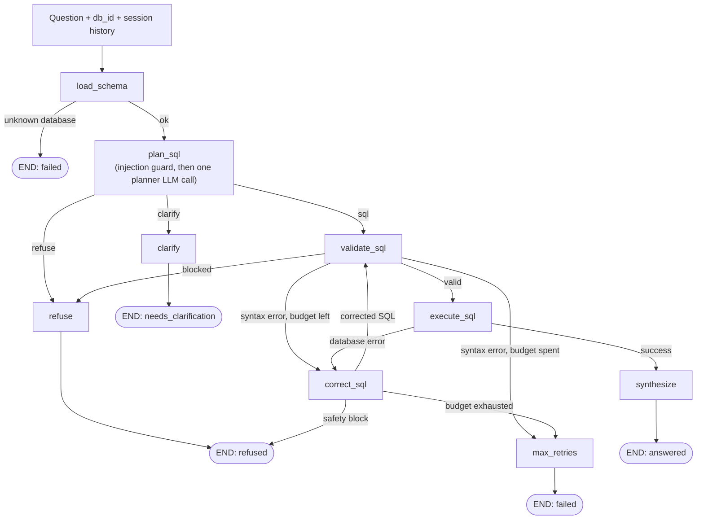

# NL-to-SQL Agent

[](https://github.com/Hitesh-Prajapathi/nl2sql-agent/actions/workflows/ci.yml)

A natural-language-to-SQL agent for PostgreSQL. It turns a business question into a validated, read-only SQL query, runs it, and explains the answer. It is a LangGraph state machine served through an authenticated FastAPI service, with layered SQL-safety defences measured against a 436-payload red-team suite, plus a BIRD Mini-Dev evaluation harness. It runs on Groq-hosted models (`openai/gpt-oss-120b` planner, `openai/gpt-oss-20b` fast and fallback model).

## Highlights

- **Safety measured, not assumed.** The SQL validator blocked 62.2% (271/436) of red-team payloads as a denylist and 100% (436/436) after being rewritten as an allowlist, with 0 false blocks on 75 benign analytical queries ([v1](results/redteam_sql_v1.json), [v2](results/redteam_sql_v2.json)).
- **Defence in depth.** Every payload was also run directly against the database role with the validator bypassed. Payloads that would succeed at the database fell from 170 to 54 after REVOKE-based hardening ([v2](results/redteam_sql_v2.json), [v3](results/redteam_sql_v3.json)). A checksum canary over all 8 tables showed that no write got through.
- **No false blocks on a real benchmark.** The validator blocked 0 of the 500 BIRD Mini-Dev gold queries, and all 500 ran on PostgreSQL without an execution error ([result](results/bird_minidev_gold_check_2026-11-14.json)).
- **A load-test bottleneck found and fixed.** With a mock LLM, throughput plateaued near 6 RPS because of the LLM concurrency semaphore (8), not the database pool. Raising the cap to 64 gave 55.8 RPS at P95 2.6 s, up from 6.1 RPS at P95 14.4 s, with 0% errors ([baseline](results/loadtest_mock_2026-11-14_baseline.md), [tuned](results/loadtest_mock_2026-11-14_llmconc64.md)).
- **Production-style API.** Hashed API keys, token-bucket rate limiting, SSE streaming, request IDs, an LLM kill switch, an append-only audit log, Prometheus metrics, OpenTelemetry and Langfuse tracing, and pluggable session stores (memory, PostgreSQL, Redis).
- **Built for a free-tier LLM.** A rate-limit pacer, resumable evaluation checkpoints and a size-capped schema variant keep benchmark runs inside Groq free-tier limits.

The repository has 1,492 passing tests (13 skipped, Redis-only), and `ruff` and strict `mypy` are clean.

## Architecture



Each node, the state it reads and writes, and the routing rules are described in [docs/ARCHITECTURE.md](docs/ARCHITECTURE.md). The correction node feeds the real database or validator error back to the model and is bounded by `MAX_RETRY_ATTEMPTS`.

## Safety in depth

A generated query passes through these layers. Each is independent, so a bypass of one is not a bypass of the system.

1. **Natural-language injection guard.** Pattern-based, runs before any LLM call.
2. **AST validator** (`src/nl2sql/safety/`). A sqlglot parse in the Postgres dialect. Only a single `SELECT` is accepted, with an allowlist of functions and typed nodes, system schemas blocked, a table allowlist built from the loaded schema (an unknown table goes back to the model for correction instead of being refused), and a lexical pre-scan that follows PostgreSQL's own lexing rules to defeat parser-differential tricks.
3. **Read-only database role and session.** A `SELECT`-only role, read-only transactions, and statement and lock timeouts ([db/setup_role.sql](db/setup_role.sql)).
4. **Database hardening** ([db/hardening.sql](db/hardening.sql)). `REVOKE EXECUTE` on dangerous built-in functions, locked-down catalog views, and a pinned `search_path`.
5. **Separate audit role.** Every request is logged to `audit.query_log` by a dedicated writer role; the agent's role cannot read it ([db/audit.sql](db/audit.sql)).

### Red-team results (SQL suite)

436 attack payloads in 18 categories, plus 75 benign queries. Each run also executes every payload directly against the database role to count which layers would stop it.

| Metric | v1 (denylist) | v2 (allowlist) | v3 (allowlist + DB hardening) | v4 (+ table allowlist) |
|---|---|---|---|---|
| Validator block rate | 62.2% (271/436) | 100% (436/436) | 100% (436/436) | 100% (436/436) |
| False blocks on 75 benign queries | 0% | 0% | 0% | 0% |
| Payloads that would succeed at the database if the validator were bypassed | not tabulated | 170 | 54 | 54 |
| Payloads caught by only one defence layer | not tabulated | 218 | 94 | 94 |
| Database write canary (checksums of all 8 tables) | not tabulated | not tabulated | unchanged | unchanged |

Sources: [results/redteam_sql_v1.json](results/redteam_sql_v1.json), [v2](results/redteam_sql_v2.json), [v3](results/redteam_sql_v3.json), [v4](results/redteam_sql_v4.json). The v4 run is the same payload set after the table allowlist was wired into the graph; the red-team suite calls the validator without a table list, so its numbers match v3, and the allowlist itself is covered by unit tests and the gold-SQL check below. The suite lives in [redteam/](redteam/). It shows the rate on this payload set, not the absence of vulnerabilities.

The natural-language guard scores 100% detection and 0% false positives on its own 95-item set, but that set was visible while the patterns were written, so the score is overfit. The old regex guard scored 48% detection and 20% false positives on the dev split ([v3 results](results/redteam_sql_v3.json)). See [Limitations](#limitations).

## Results

| Check | Result | Source |
|---|---|---|
| SQL red team | 100% block (436/436), 0 false blocks on 75 benign queries | [v2](results/redteam_sql_v2.json) |
| DB hardening | Payloads succeeding at the DB if the validator were bypassed: 170 to 54 | [v2](results/redteam_sql_v2.json), [v3](results/redteam_sql_v3.json) |
| BIRD Mini-Dev gold SQL through the validator | 0 of 500 falsely blocked, 0 execution errors | [result](results/bird_minidev_gold_check_2026-11-14.json) |
| Same check with each database's table allowlist applied, as the graph does | 0 of 500 falsely blocked, 0 execution errors | [result](results/bird_minidev_gold_check_allowlist_2026-11-15.json) |
| Load test, mock LLM, 1 worker, 100 users, `LLM_MAX_CONCURRENCY` 8 to 64 | 6.1 RPS / P95 14.4 s to 55.8 RPS / P95 2.6 s, 0% errors | [baseline](results/loadtest_mock_2026-11-14_baseline.md), [tuned](results/loadtest_mock_2026-11-14_llmconc64.md) |
| Load test, mock LLM, 100 users, 1 vs 4 workers (PostgreSQL sessions) | 27.7 to 58.9 RPS, P95 4.2 s to 2.6 s, 0% errors; follow-up conversations correct across workers (40/40) | [workers](results/loadtest_mock_2026-11-15_workers.md) |

**Mock-LLM caveat.** The load tests use a fake LLM with assumed latencies (planner median 900 ms). They measure the service's own capacity, not real LLM throughput. The 4-worker gain comes from the larger combined LLM concurrency cap (4 x 32), not from CPU scaling. The gold-SQL check validates and executes the benchmark's reference queries; it says nothing about the accuracy of generated SQL.

## BIRD Mini-Dev benchmark

The harness for the BIRD Mini-Dev benchmark (500 questions, PostgreSQL dialect) is complete: one-command setup, resumable runs, execution accuracy, Soft-F1, R-VES, schema-linking recall, 95% bootstrap confidence intervals, a fixed-seed stratified 150-question subset, and four variants (`full`, `naive`, `full_small`, `naive_small`).

**The headline accuracy runs have not been completed**, because they were stopped partway by Groq free-tier token limits. No accuracy number is reported here.

```bash
make bird-setup                        # download and load BIRD Mini-Dev (see docs/BIRD_SETUP.md)
make profile                           # build schema profiles for all databases
make prompt-size VARIANT=full_small    # offline check of the token cap over all 500 questions
make eval VARIANT=full_small           # run; stops cleanly at the daily budget, rerun to resume
make report                            # regenerate the table below from complete runs
```

<!-- RESULTS:START -->
_No complete BIRD Mini-Dev run has been recorded yet. Run `make eval`._
<!-- RESULTS:END -->

## Quickstart

Prerequisites: Python 3.11+, [uv](https://github.com/astral-sh/uv), Docker, and a Groq API key.

```bash
cp .env.example .env        # set GROQ_API_KEY
make setup                  # uv sync --extra dev
make docker-up              # Postgres 16 on localhost:5432, seeded from db/
```

### CLI

```bash
make cli                                          # multi-turn chat
make ask Q="How many customers are in each tier?"
uv run nl2sql ask "Top 3 customers by total spending" --json
```

### API

```bash
make dev        # uvicorn with reload on :8000; UI at /, OpenAPI docs at /docs
```

Authentication is on when `API_KEY_HASHES` is non-empty. Generate a key hash and put it in `.env`:

```bash
python -c "import hashlib;print(hashlib.sha256(b'my-secret-key').hexdigest())"
# .env:  API_KEY_HASHES=demo:<the hex digest above>
```

```bash
curl -s -X POST localhost:8000/v1/query \
  -H 'content-type: application/json' \
  -H 'X-API-Key: my-secret-key' \
  -d '{"question": "How many orders were placed last month?", "thread_id": "demo-1"}'

# Server-Sent Events: "node" events as the graph runs, then a final "result" event
curl -N -X POST localhost:8000/v1/query/stream \
  -H 'content-type: application/json' \
  -H 'X-API-Key: my-secret-key' \
  -d '{"question": "Top 5 customers by total completed payment amount"}'
```

Reuse the same `thread_id` for follow-up questions. Other endpoints: `GET /healthz`, `GET /readyz`, `GET /health`, `GET /metrics`. The header name is set by `API_KEY_HEADER`. With `API_KEY_HASHES` empty, authentication is off and the header can be omitted.

### Docker

```bash
docker compose up --build app                       # app + Postgres, no reload
docker compose --profile dev up --build app-dev     # live reload (do not run beside `app`; same port)
docker compose --profile redis up -d redis          # optional shared session store
```

## Configuration

All settings are in [.env.example](.env.example), which maps 1:1 to `src/nl2sql/config.py`.

| Variable | Purpose | Default |
|---|---|---|
| `LLM_PROVIDER` | `groq` or `fake` (offline, for tests and CI) | `groq` |
| `GROQ_API_KEY` | Required when `LLM_PROVIDER=groq` | empty |
| `PLANNER_MODEL`, `FAST_MODEL`, `FALLBACK_MODEL` | Groq model IDs | `openai/gpt-oss-120b`, `openai/gpt-oss-20b`, `openai/gpt-oss-20b` |
| `DATABASE_URL` | Read-only role DSN used by the agent | `nl2sql_reader` on localhost |
| `MAX_RETRY_ATTEMPTS` | Correction LLM calls per question (0 disables) | 3 |
| `QUERY_ROW_CAP`, `STATEMENT_TIMEOUT_MS` | Rows fetched; per-query timeout | 500, 15000 |
| `API_KEY_HASHES`, `API_KEY_HEADER` | `key_id:sha256hex` pairs; header name | empty (auth off), `X-API-Key` |
| `RATE_LIMIT_PER_KEY_PER_MIN`, `RATE_LIMIT_PER_IP_PER_MIN` | Token-bucket limits | 60, 120 |
| `LLM_TIMEOUT_SECONDS`, `LLM_MAX_RETRIES`, `LLM_MAX_CONCURRENCY` | LLM resilience | 30, 3, 32 |
| `LLM_KILL_SWITCH` | Reject all LLM-backed requests | false |
| `AUDIT_ENABLED`, `AUDIT_DATABASE_URL` | Audit log writer | true, `audit_writer` DSN |
| `SESSION_BACKEND` | `memory`, `postgres` or `redis` | `memory` |
| `PROMETHEUS_MULTIPROC_DIR` | Required with more than one worker | unset |
| `OTEL_EXPORTER_OTLP_ENDPOINT` | OpenTelemetry export target | empty |
| `LANGFUSE_PUBLIC_KEY`, `LANGFUSE_SECRET_KEY`, `LANGFUSE_HOST` | Langfuse tracing (both keys required) | empty |

For several workers, use a shared session store: `make dev-multi` starts 4 workers with the PostgreSQL backend (apply `db/app_state.sql` once first).

## Testing and quality

```bash
make test          # all tests (integration tests need the Postgres container)
make test-unit     # excludes tests marked integration
make test-safety   # validator, SQL red-team and injection-guard tests
make test-e2e      # graph end-to-end tests
make lint          # ruff check
make fmt           # ruff format
make check         # ruff check + mypy
```

Evaluation and red-team commands:

```bash
make redteam-sql                                          # SQL payloads + benign queries, no LLM
make redteam-nl-setup                                     # one-off: create the nl2sql_redteam database
make redteam-nl LABEL=v1 RT_ARGS=--confirm-real-llm       # NL red team; refuses a real model without the flag
make eval-clarify LABEL=v1 CLAR_ARGS=--confirm-real-llm   # clarification eval, same guard
make loadtest                                             # mock-LLM load test (starts its own server on :8765)
make eval VARIANT=full_small                              # BIRD Mini-Dev run (see above)
```

CI ([.github/workflows/](.github/workflows/)) runs lint, format, mypy and tests, builds the Docker image, and has an opt-in evaluation smoke gate and a nightly evaluation job.

## Observability

- **Prometheus.** `GET /metrics` exposes request counts and latency, per-node latency, safety blocks by layer, LLM retries, fallbacks, breaker state, token counts and rate-limit hits. Multi-worker mode uses `PROMETHEUS_MULTIPROC_DIR`.
- **Grafana.** Import [ops/grafana/nl2sql-dashboard.json](ops/grafana/nl2sql-dashboard.json).
- **OpenTelemetry.** Set `OTEL_EXPORTER_OTLP_ENDPOINT` to export traces; each request gets a span and its trace ID is returned in the response.
- **Langfuse.** Set both `LANGFUSE_*` keys for LLM-level tracing grouped by session.
- **Logs.** Structured JSON via structlog, with the request ID bound to every line (`X-Request-ID` is accepted and echoed).

## Project layout

```
src/nl2sql/
  agent/       LangGraph graph, state, nodes (plan, execute/correct, synthesize)
  safety/      AST validator, function allowlist, injection guard
  schema/      introspection, pg_stats profiling, capped schema rendering
  db/          pools, read-only executor, multi-database registry
  llm/         providers (Groq, fake), resilience stack, rate-limit pacer, prompts
  api/         FastAPI app, auth, rate limiting, sessions, CLI
  audit/       audit writer
  telemetry/   Prometheus metrics, OpenTelemetry, Langfuse
  eval/        BIRD harness: runner, metrics, variants, results
db/            schema, seed data, roles, hardening and audit SQL
redteam/       SQL payload suite and the NL red-team suite (redteam/nl/)
evalsets/      clarification evaluation set
loadtest/      Locust load test with a mock LLM
ops/grafana/   dashboard
results/       committed result files cited above
docs/          ARCHITECTURE.md, BIRD_SETUP.md
tests/         unit, integration and end-to-end tests
```

## Limitations

- **Free tier only.** Everything ran on Groq's free tier, which is why the BIRD accuracy runs are unfinished.
- **Mock-LLM load tests.** There are no real-LLM latency or throughput numbers.
- **The NL injection guard is overfit.** Its 100% / 0% score comes from a set that was visible during development. An informal check on 30 fresh items found 13 of 15 attacks detected and 0 of 15 false positives; it was not saved as a results file. Treat the guard as a cheap first filter, not a defence on its own.
- **NL red-team and clarification suites are built but not yet run** against the real model. Both are unit-tested offline, with objective oracles and no LLM judge.
- **No hosted demo**, no production deployment and no real users.

## Roadmap

- Finish the BIRD Mini-Dev runs and report accuracy with confidence intervals.
- Ablations across the four variants.
- Run the NL red-team suite against the real model.
- Add a spotlighting (data-delimiting) defence against indirect prompt injection, using the NL red-team result as the "before" measurement.
