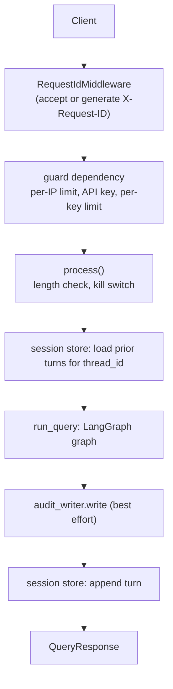
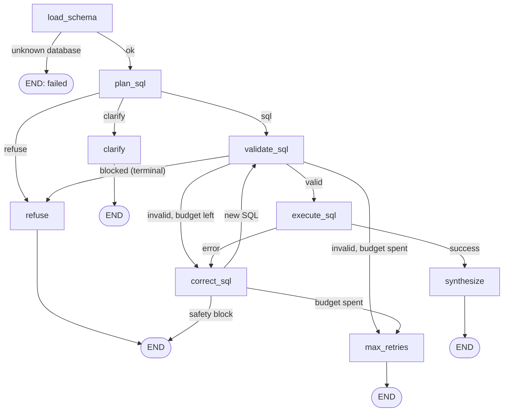

# Architecture

This document walks through the current code. For the project overview and measured results, see the [README](../README.md).

## Contents

1. [Request lifecycle](#request-lifecycle)
2. [The agent graph](#the-agent-graph)
3. [State](#state)
4. [Schema profiling and capping](#schema-profiling-and-capping)
5. [Safety layers](#safety-layers)
6. [LLM provider resilience and the pacer](#llm-provider-resilience-and-the-pacer)
7. [Sessions](#sessions)
8. [The API](#the-api)
9. [Telemetry](#telemetry)
10. [Evaluation harness](#evaluation-harness)

## Request lifecycle

`POST /v1/query` (also served at `/query`) and `POST /v1/query/stream` share one pipeline, `process()` in `src/nl2sql/api/app.py`. The steps:

1. The request-ID middleware accepts a valid `X-Request-ID` (alphanumeric, `-`, `_`, at most 64 characters) or generates one, binds it to the log context, and echoes it in the response header.
2. The `guard` dependency applies the per-IP rate limit, then, if any API key hashes are configured, authenticates the key and applies the per-key limit. Failures raise typed `ApiError`s (`unauthorized`, `rate_limited`) with a `Retry-After` header.
3. `process()` rejects empty questions (400) and questions longer than `MAX_QUESTION_CHARS` (413), returns 503 if the graph is not initialised, and returns 503 `kill_switch` if the LLM kill switch is on.
4. Prior turns for the `thread_id` are loaded from the session store (a new UUID is used if the client sent none).
5. The graph runs inside an OpenTelemetry `request` span, with a `RequestObserver` (token counts, per-node spans and latency) and, when configured, a Langfuse callback attached.
6. In a `finally` block, request latency and outcome metrics are recorded, safety blocks are counted by layer, and an audit record is written.
7. The turn (question, decision, SQL, answer) is appended to the session store, and a `QueryResponse` is returned with status, answer, SQL, raw columns and rows, assumptions, attempt count, trace ID, per-node timings, request ID, and token counts.

## The agent graph

Built in `build_graph()` (`src/nl2sql/agent/graph.py`) as a LangGraph `StateGraph` over `AgentState`.

### Nodes

| Node | What it does |
|---|---|
| `load_schema` | Resolves the request's `db_id` in the `DatabaseRegistry` and loads the schema context, the display name and the data date ranges into state. An unknown database ends the run with status `failed` before any LLM call. |
| `plan_sql` | First runs the pattern-based prompt-injection guard; a hit refuses immediately, with no LLM call. Otherwise it builds the planner prompt (schema context, the question, optional BIRD evidence, and a follow-up block from prior turns) and makes one structured-output call on the planner model. The result (`PlanResult`) carries a decision (`sql`, `clarify` or `refuse`), the SQL, stated assumptions, a clarification question or refusal reason, a follow-up flag, and two chain-of-thought fields (relevant tables, ambiguity analysis) kept for telemetry. An LLM failure becomes status `failed` with `llm_error` set. |
| `clarify` | Terminal. Sets status `needs_clarification` and the answer to the clarifying question. |
| `refuse` | Terminal. Status `refused`, with either the validator's block reason or the planner's refusal text. A `failed` status set earlier (LLM error) is preserved. |
| `validate_sql` | Synchronous, no I/O. Runs `validate_sql()` and records `is_valid_sql`, `is_blocked` and the error. |
| `execute_sql` | Runs the SQL on the request's database pool in a read-only transaction through a prepared statement and a server-side cursor. In evaluation mode the row cap is lifted. |
| `correct_sql` | Classifies the error and asks the planner model for a corrected query, given the failed SQL and the real error text. See below. |
| `max_retries` | Terminal failure after the correction budget is spent. The answer includes the last error. |
| `synthesize` | Builds the answer. Reached only after a successful execution. See below. |

### Routing rules

- `route_after_plan`: `clarify` and `refuse` decisions go to their nodes; anything else goes to validation.
- `route_after_validation`: a blocked query is a terminal refusal with no retry. A retryable syntax error goes to `correct_sql` while budget remains, else to `max_retries`. A valid query goes to execution.
- `route_after_execution`: an execution error goes to `correct_sql`, otherwise to `synthesize`.
- `route_after_correction`: a safety block ends the run as refused; an exhausted budget goes to `max_retries`; otherwise the new SQL goes back to `validate_sql` (and from there to execution).

### Self-correction

`correct_sql_node` classifies the error as `syntax`, `timeout`, `safety` or `unknown`. A `safety` error (the database rejected the query for permissions or read-only reasons, or the validator blocked it) is terminal and makes no LLM call. Otherwise it checks the budget before spending an LLM call: `MAX_RETRY_ATTEMPTS` is the number of correction calls allowed, so 0 disables correction. Each attempt is recorded in `attempts` with the SQL, the error and its classification. The correction prompt includes the question, the failed SQL (truncated to 2,000 characters), the actual error (truncated to 600 characters), an error-class-specific instruction (for example, "simplify the query" after a timeout), and the schema context.

### Synthesis

`synthesize_node` avoids an LLM call where it can:

- evaluation mode: no answer text, only the executed SQL;
- empty result: a template that mentions the data's date range;
- single scalar: `**value**` plus any assumptions;
- 50 rows or fewer, or a list-style question: a deterministic markdown table;
- larger results: the fast model narrates a sample of the first 25 rows, falling back to a table if that call fails.

## State

`AgentState` (`src/nl2sql/agent/state.py`) is a `TypedDict`. The groups of fields:

| Group | Fields |
|---|---|
| Input | `messages`, `question`, `thread_id`, `conversation_history`, plus optional `eval_mode`, `evidence`, `llm_error` |
| Schema | `schema_context`, and optional `db_id`, `db_display_name`, `data_date_ranges` |
| Planning | `decision`, `assumptions`, `clarification_question`, `refuse_reason`, `is_followup` |
| SQL | `generated_sql`, `cot_relevant_tables`, `cot_ambiguity_analysis`, `is_valid_sql`, `is_blocked`, `validation_error` |
| Execution | `exec_columns`, `exec_rows`, `exec_row_count`, `exec_truncated`, `exec_error`, `is_safety_exec_block` |
| Correction | `attempt_count`, `correction_context`, `attempts` |
| Output | `status` (`answered`, `needs_clarification`, `refused`, `failed`), `final_answer`, `final_sql` |
| Telemetry | `trace_id`, `timings` (per-node milliseconds) |

## Schema profiling and capping

Code: `src/nl2sql/schema/`.

**Introspection** (`introspect.py`) reads everything from `pg_catalog` for the connection's resolved schema, so a pool whose role pins `search_path` to one schema sees exactly that database:

- row counts come from `pg_class.reltuples` (an exact `COUNT(*)` only for never-analysed small tables);
- value grounding comes from `pg_stats` (`n_distinct`, `most_common_vals`) instead of one `SELECT DISTINCT` per text column; a string column with at most 30 distinct values is shown as a complete value list;
- date columns get ranges, which `synthesize` later uses in empty-result answers;
- the result is a plain, JSON-serialisable profile that can be built offline (`make profile`) and loaded from `data/profiles`;
- rendering applies a per-table token budget (1,500 tokens by default) with truncated sample values (60 characters, control characters removed). Sampled cell values reach the planner prompt, which is why the NL red team plants instructions in database rows.

**Capping** (`capped.py`) serves the `*_small` evaluation variants, where prompt plus output must stay under 6,500 tokens for the Groq free tier. Per question it ranks tables by lexical overlap of the question and evidence with table names, column names and stored values (gold SQL is never used), adds foreign-key neighbours as join bridges, then fills the budget greedily. Each table is rendered at the richest level that fits, dropping unmatched non-key columns before giving up on a table. A final hard truncation is the last resort and is reported. `make prompt-size` checks the cap offline over all 500 questions.

**Providers**: `FullSchemaProvider` introspects live, and `StoredProfileSchemaProvider` serves a saved profile. Introspection skips tables the connected role cannot `SELECT` from (`has_table_privilege`), logging one warning per skipped table; skipped tables never reach the prompt or the table allowlist. `DatabaseRegistry` (`db/registry.py`) maps a `db_id` to a lazily created pool plus a schema provider and profile, which is how one process serves several databases, each with its own read-only role.

## Safety layers

There are five layers. They are independent: each is designed to stop attacks on its own.

### 1. Natural-language injection guard

`detect_prompt_injection()` in `safety/validator.py` runs inside `plan_sql` before any LLM call. It normalises the text (NFKC, zero-width characters removed) and tests a list of regexes that require an imperative structure (an override verb followed by an instruction-like object, a role marker at the start of a line, a persona switch, a request to reveal the prompt, a request to disable safeguards) rather than bare trigger words, to avoid refusing ordinary business questions. It is a cheap filter, and it is overfit to its development set (see the README's limitations).

### 2. AST validator

`validate_sql()` returns a result that is valid, retryable-invalid, or blocked (terminal, no retry). The rules, in order:

0. **PostgreSQL-faithful lexical pre-scan.** sqlglot's tokenizer disagrees with PostgreSQL in places that matter. For example, it treats `\'` as an escaped quote inside an ordinary string, so `SELECT 'a\' || pg_sleep(5) || '...'` parses as one literal and hides the function call from every AST check, while PostgreSQL sees the call. The scanner follows PostgreSQL's rules and rejects constructs whose meaning differs between the two parsers: dollar-quoted strings, `E''` and `U&''` literals, and backslashes in ordinary literals. It also counts statements independently of the parser.
1. Exactly one statement.
2. The root must be a `SELECT` (a `WITH` whose body is a `SELECT` is fine). Other statement types, including `Command` nodes such as `DO`, `CALL`, `SET`, `EXPLAIN`, are blocked.
3. No DML or DDL node anywhere in the tree, including inside CTEs.
4. No `SELECT ... INTO`, no `FOR UPDATE` or `FOR SHARE`.
5. **Function allowlist.** Every function call must be in `safety/allowlist.py`: aggregate, math, string, date and time, conditional, cast, JSON and window functions. Anything else is blocked, whatever it is called, so a new dangerous function cannot slip through the way `query_to_xml` did under the old denylist. Two namespaces are covered, because sqlglot parses known functions into typed nodes and the rest into `Anonymous` nodes. Schema-qualified calls, session keyword functions such as `user`, casts to `reg*` and `oid` types, and environment-disclosing functions (`version`, `current_user`, `current_database`) are blocked. `generate_series` is bounded: the product of literal spans must stay below a row limit. The old `DANGEROUS_FUNCTIONS` list is kept only to make error messages more informative.
6. **Schemas.** System schemas (`pg_catalog`, `information_schema`, `pg_toast`, `pg_temp`), table names starting with `pg_`, cross-database references and any schema other than `public` are blocked.
7. **Tables.** `validate_sql` accepts an optional `allowed_tables` set (plus the query's own CTE names). The graph passes it: `load_schema_node` stores the table names of the loaded schema in the state (`schema_tables`, from the schema provider's `table_names()`, which covers every table of the database even when the capped prompt shows fewer), and `validate_sql_node` hands them to the validator. Names are compared case-insensitively, `public.` qualification and quoting are handled as in the other checks, and BIRD's schema-per-database layout needs nothing special because each pool pins `search_path` and queries use bare table names. The two kinds of failure are routed differently. System schemas, `pg_` tables, cross-database references and other schemas stay terminal blocks (`refuse`). A reference to a table that is not in the schema is a hallucination, so it is a retryable validation error (`is_blocked=False`) routed to `correct_sql`, like a syntax error; terminal checks run over every table first, so an unknown table can never mask a system-schema reference. A provider that cannot list its tables (returns `None`) means no table allowlist, and the database role's grants remain the backstop. With each BIRD database's table set applied, 0 of 500 gold queries are falsely blocked ([result](../results/bird_minidev_gold_check_allowlist_2026-11-15.json)). The SQL red-team suite was re-run as [v4](../results/redteam_sql_v4.json): 436/436 blocked, 0 of 75 benign queries falsely blocked (the suite itself calls the validator without a table list).

### 3. Database role and session

`db/setup_role.sql` creates `nl2sql_reader` with `CONNECT`, `USAGE` on `public` and `SELECT` only, `default_transaction_read_only=on`, and statement, lock and idle-in-transaction timeouts. The pool (`db/connection.py`) sets the same read-only default and timeouts per connection, and the executor opens a read-only transaction for each query. Results are fetched through a server-side cursor, so at most `QUERY_ROW_CAP + 1` rows are pulled (the extra row detects truncation), and results over 5 MB serialised are truncated. Execution never raises; failures come back as an error string the correction node can use.

### 4. Database hardening

`db/hardening.sql` is idempotent and runs as a superuser. It:

- revokes `EXECUTE` from `PUBLIC` on every overload of dangerous built-ins, matched by name pattern so new overloads are covered (string-SQL executors such as `query_to_xml`, sleep and advisory locks, config read and write, sequence and WAL functions, backend control, file access, and others), then grants back only what the application needs, such as `current_database()` for the profiler and `pg_advisory_unlock_all()` that asyncpg runs on connection release;
- hides server-wide catalog views and `information_schema` views the profiler does not read, while leaving core relation catalogs readable because driver type introspection needs them (the SQL file documents this limit);
- revokes `USAGE` on the `plpgsql` language so `DO` blocks fail;
- pins the role's `search_path` to `public, pg_catalog`.

Applying it is `make db-harden`; the Compose Postgres container runs it at first start.

### 5. Audit role

`db/audit.sql` creates the `audit` schema and `audit.query_log` (request ID, key ID, question hash rather than the question text, SQL, status, blocked layer, row count, latency, trace ID), with triggers that reject updates, deletes and truncation. `audit_writer` can connect and insert; `PUBLIC` has no access, and the agent role has none either. `AuditWriter` uses its own small pool, a 2 s write timeout, and a 30 s back-off after a failure. Writes are best effort and never fail the request.

The API labels a block as `ast_validator` or `database` for metrics and the audit log, based on whether the validator or the database rejected the query.

## LLM provider resilience and the pacer

Code: `src/nl2sql/llm/providers.py`, `src/nl2sql/llm/pacer.py`.

`LLM_PROVIDER` selects `groq` or `fake`. The fake provider is deterministic and offline: a process-wide script with response queues per channel (`plan`, `correct`, `fast`), optional scripted failures and optional simulated latency. It drives the tests, CI and the mock-LLM load test.

Groq models are wrapped in `ResilientChatModel`. Every call goes through `resilient_call`:

1. **Circuit breaker.** After `LLM_BREAKER_FAILURE_THRESHOLD` consecutive failed calls it opens; after `LLM_BREAKER_RESET_SECONDS` it lets one trial through. Non-transient errors (bad request, parse error) do not count as provider health failures.
2. **Per-attempt pacing, then a concurrency semaphore, then a timeout.** Pacing happens outside the semaphore and the timeout, so a request waiting for tokens neither holds a slot nor uses up its own timeout. `LLM_MAX_CONCURRENCY` bounds in-flight calls per process; `LLM_TIMEOUT_SECONDS` bounds each attempt.
3. **Jittered exponential backoff.** Retryable failures (429, 5xx, timeout, connection errors) are retried up to `LLM_MAX_RETRIES` times, with the delay drawn uniformly from zero up to a capped exponential.
4. **Fallback model.** If the primary model keeps failing with a retryable error, the call moves to `FALLBACK_MODEL`. If the breaker is open and no fallback exists, `LLMUnavailableError` is raised.

Retries, fallbacks, breaker state and tokens are exported as Prometheus metrics.

**The pacer** keeps the free tier usable. Per model it holds a token bucket sized to the tokens-per-minute limit, reserves the estimated prompt tokens plus the maximum output tokens before a request, and returns the unused part afterwards. It counts every HTTP attempt against a requests-per-day budget persisted to a small JSON file, so a run stopped by the daily limit resumes correctly and several processes share one count. On a 429 it reads `retry-after` and the error text to set a shared cooldown, and tells per-minute limits from per-day ones. A daily 429 triggers an escalating backoff; only after repeated daily 429s over a minimum span is the model marked exhausted. `DailyBudgetExhausted` is never retried and never falls back, so callers stop cleanly and resume later. A request larger than the bucket is refused locally instead of waiting forever. Cooldowns are deadlines on the wall clock, and any wait longer than 30 s is slept in slices of at most 30 s toward that deadline (`wall_sleep`), because the monotonic clock pauses while a laptop sleeps and a plain `asyncio.sleep` would otherwise outlast the deadline by the suspended time; the evaluation runner's infrastructure backoff uses the same helper.

The evaluation harness installs an `LLMHook` (a context variable, so concurrent questions stay isolated) that adds an on-disk response cache and per-node token accounting without changes to node code.

## Sessions

`SessionStore` is a small protocol (`get`, `append`) in `api/sessions.py`, selected by `SESSION_BACKEND`:

| Backend | Notes |
|---|---|
| `memory` | Default. LRU of up to `SESSION_MAX_SESSIONS` sessions, with a TTL. One worker only. |
| `postgres` | Table `app_state.sessions` and role `app_state_writer` (`db/app_state.sql`). Appends run in a transaction holding a row lock, so concurrent appends to one thread serialise; expiry uses the database clock, which is consistent across workers. |
| `redis` | One list per thread (optional `redis` extra, Compose profile `redis`). The append, trim and TTL refresh run as one Lua script, so they are atomic. |

All backends enforce `SESSION_MAX_TURNS` and `SESSION_MAX_BYTES`; a single oversized turn is dropped rather than stored. Prior turns are rendered into the planner prompt as a follow-up block. The Redis tests are skipped when no Redis is available.

## The API

Code: `src/nl2sql/api/`.

| Endpoint | Purpose |
|---|---|
| `POST /v1/query` (also `/query`) | Run a question. Body: `question`, optional `thread_id`, optional `database`. |
| `POST /v1/query/stream` | Same pipeline as Server-Sent Events: a `node` event as each graph node finishes, then a final `result` event (or an `error` event). Validation errors before streaming starts are normal JSON errors. |
| `GET /healthz`, `GET /health` | Liveness. `/health` also reports the version. |
| `GET /readyz` | Readiness: checks the database and that the graph is built. |
| `GET /metrics` | Prometheus exposition (404 if `METRICS_ENABLED` is off). |

A static single-page UI is mounted at `/` after the API routes.

- **Auth** (`security.py`): keys are configured as `key_id:sha256hex` pairs. The presented key is hashed and compared in constant time. With no hashes configured, auth is off.
- **Rate limiting**: an in-memory token bucket per client IP and per key, behind a `RateLimiter` protocol so a shared implementation can replace it. Limits are per minute.
- **Errors** (`errors.py`): all errors use one JSON envelope with a stable `code`.
- **Kill switch** (`spend.py`): `LLM_KILL_SWITCH` makes `process()` return 503 `kill_switch`.

## Telemetry

Code: `src/nl2sql/telemetry/`.

- **Prometheus** (`metrics.py`): request counts and latency by route and outcome, per-node latency, safety blocks by layer, LLM retries by reason, fallbacks, circuit-breaker state, input and output tokens, and rate-limit rejections. With more than one worker, set `PROMETHEUS_MULTIPROC_DIR` so metrics aggregate across processes.
- **Grafana**: `ops/grafana/nl2sql-dashboard.json`.
- **OpenTelemetry** (`tracing.py`): a `request` span per call and a `node.<name>` span per graph node, exported over OTLP when `OTEL_EXPORTER_OTLP_ENDPOINT` is set. The trace ID is returned in the response and written to the audit log.
- **Langfuse** (`setup.py`): enabled only when both keys are set; the session ID is the `thread_id`.
- **Logs**: structlog JSON with the request ID bound.

## Evaluation harness

Code: `src/nl2sql/eval/`, `scripts/`, `config/`.

**Data and setup.** `make bird-setup` loads the BIRD Mini-Dev PostgreSQL dump into one database with a schema per `db_id` and one read-only role per schema, so per-database isolation does not rely on `SET search_path`. See [BIRD_SETUP.md](BIRD_SETUP.md).

**Variants** (`variants.py`): `full` is the agent graph in evaluation mode (no synthesis, uncapped rows); `naive` is a single-prompt baseline with raw DDL, no profiling, no chain-of-thought, no validation and no correction. The `_small` variants choose the schema text per question under the token cap.

**Scoring** (`metrics.py`, `sqlrunner.py`): execution accuracy, Soft-F1 and R-VES are ports of the official BIRD Mini-Dev scripts at a pinned commit, with documented deviations (a configurable repeat count for R-VES, and timing only execution and fetch). Schema-linking recall is also computed, and `stats.py` provides percentile bootstrap confidence intervals. Both the prediction and the gold SQL are re-executed by evaluation-owned code, because the API executor keys rows by column name (duplicate names collapse) and truncates at 5 MB. Gold SQL deliberately bypasses the validator, and `check-gold` reports how many gold queries the validator would block.

**Runner** (`runner.py`): bounded concurrency, a resumable JSONL checkpoint keyed by a run fingerprint, and a stratified fixed-seed 150-question subset (`scripts/make_subset.py`, `config/bird_subset_150.txt`). With a pacer attached, the runner stops starting questions when the daily budget cannot cover another one, and stops cleanly on the first budget hit mid-flight. Rerunning the same command resumes.

**Results** (`results.py`, `scripts/report.py`): each run writes a self-describing JSON file (git SHA, models, prompt hash, dataset hash, per-question records). `make report` renders tables from complete 500-question runs only, and replaces the text between the `RESULTS:START` and `RESULTS:END` markers in the README. With `--check` it fails if the README is stale.

**Other suites** share this design: the SQL red team (`redteam/run_sql_suite.py`), the NL red team (`redteam/nl/`, objective oracles and no LLM judge), and the clarification eval (`evalsets/clarification/`). The NL and clarification runners refuse any non-fake provider unless `--confirm-real-llm` is passed.

The headline BIRD accuracy runs have not been completed because of free-tier token limits, so no accuracy figure is reported anywhere in this repository.
