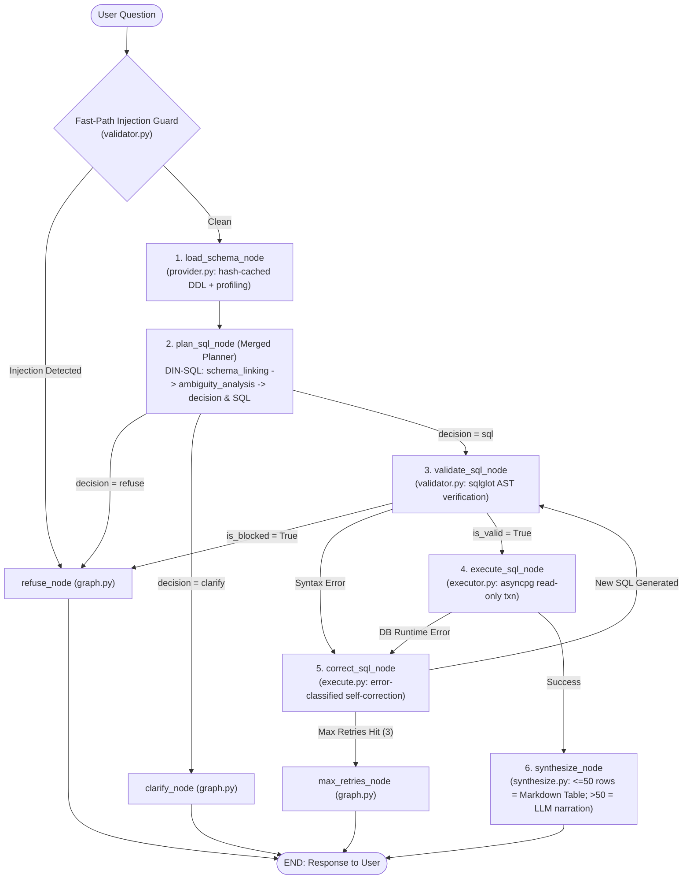

# NL2SQL Agent — End-to-End Codebase Walkthrough & Technical Review

> **Purpose:** This document provides a complete, function-by-function, file-by-file technical explanation of the entire `nl2sql-agent` repository. It is designed to prepare you to walk through, defend, and explain every line of code to a technical interviewer or senior engineering panel.

---

## 1. System Architecture & High-Level Design

### 1.1 The Problem It Solves
Most natural language to SQL (NL2SQL) scripts fail in production because of four fatal flaws:
1. **Security Vulnerabilities:** Naive LLMs generate destructive statements (`DROP`, `DELETE`) or fall victim to SQL/prompt injection.
2. **Semantic Failures (Hallucinations):** Naive LLMs guess column names, join paths, or filter values (e.g., guessing `'silver'` when the database uses `'Silver'`).
3. **High Latency:** Calling separate LLM agents for intent classification, planning, SQL generation, and synthesis adds 3–5 seconds of round-trip latency.
4. **Fragile Recovery:** When queries fail, simple retry loops pass the same error back without classification, burning tokens in infinite loops.

### 1.2 The Architectural Solution
This project implements a production-grade, state-machine agent using **LangGraph**, **Groq (Llama 3.3 70B & 8B)**, **PostgreSQL**, and **sqlglot**.



---

## 2. Directory Structure & File Map

```text
nl2sql-agent/
├── Dockerfile                     # Container definition (python:3.11-slim + uv)
├── docker-compose.yml             # Orchestration: Postgres 16 + FastAPI App
├── Makefile                       # Developer shortcuts (test, lint, run, benchmark)
├── pyproject.toml                 # PEP 621 dependencies & tool configs
├── uv.lock                        # Pinned dependency tree
├── README.md                      # Overview and setup instructions
├── WRITEUP.md                     # Engineering writeup & benchmark summary
├── INTERVIEW_PREP.md              # Interview talking points & defense guide
├── db/
│   ├── schema.sql                 # E-commerce DDL (8 tables, constraints, FKs)
│   ├── seed_data.sql              # Realistic test data (date ranges, edge cases)
│   └── setup_role.sql             # Layer 1 Security: read-only DB role setup
├── src/nl2sql/
│   ├── config.py                  # Pydantic BaseSettings environment manager
│   ├── models.py                  # Pydantic state/response contracts (PlanResult)
│   ├── agent/
│   │   ├── state.py               # AgentState TypedDict definition
│   │   ├── graph.py               # LangGraph state machine builder & routers
│   │   └── nodes/
│   │       ├── plan.py            # Node 1 (load_schema) & Node 2 (plan_sql)
│   │       ├── execute.py         # Node 3 (validate_sql), Node 4 (execute_sql), Node 5 (correct_sql)
│   │       └── synthesize.py      # Node 6 (synthesize_node)
│   ├── db/
│   │   ├── connection.py          # Global asyncpg.Pool connection lifecycle
│   │   └── executor.py            # Safe query runner (read-only txns, row-capping)
│   ├── schema/
│   │   ├── introspect.py          # Dynamic catalog profiling (distinct values, ranges)
│   │   └── provider.py            # Hash-based caching schema provider
│   ├── safety/
│   │   └── validator.py           # AST validation via sqlglot & injection regex
│   ├── llm/
│   │   ├── providers.py           # Factory functions for Groq models (70B & 8B)
│   │   └── prompts/
│   │       └── plan_sql.py        # DIN-SQL prompts & error correction templates
│   ├── telemetry/
│   │   └── setup.py               # Langfuse v4 OpenTelemetry callback handler
│   ├── api/
│   │   ├── app.py                 # FastAPI web application & REST endpoints
│   │   └── cli.py                 # Typer-based CLI & interactive REPL
│   └── static/
│       └── index.html             # Dark-mode glassmorphic chat interface
├── benchmarks/
│   ├── golden_set.py              # 40 comprehensive evaluation test cases
│   ├── run_latency.py             # Latency & throughput benchmarking runner
│   └── run_adversarial.py         # Security & jailbreak evaluation runner
└── tests/
    ├── test_safety.py             # AST validator unit tests
    └── test_schema.py             # Schema profiling & connection tests
```

---

## 3. Deep-Dive: File-by-File & Function-by-Function

---

### Module 1: Configuration & Models

#### `src/nl2sql/config.py`
Manages application configuration using `pydantic-settings`. Automatically reads from `.env` or system environment variables with type validation.
* **`Settings(BaseSettings)`**:
  * `database_url`: Connection string for the read-only user (`nl2sql_reader`).
  * `database_admin_url`: Connection string for admin/migrations (`postgres`).
  * `groq_api_key`: API key for Groq Cloud.
  * `planner_model` (`qwen/qwen3.8-27b` / `llama-3.3-70b-versatile`): Heavy model used for schema linking, planning, and SQL generation.
  * `fast_model` (`llama-3.1-8b-instant` / `qwen3.8-27b`): Lightweight model used for synthesis narration.
  * `langfuse_public_key`, `langfuse_secret_key`, `langfuse_host`: Observability credentials.
  * `max_retry_attempts` (default: 3): Cap on error-correction iterations.
  * `query_row_cap` (default: 500): Hard limit on rows fetched per query to prevent memory exhaustion.
  * `statement_timeout_ms` (15,000ms): Hardware query timeout.
  * `lock_timeout_ms` (5,000ms): Lock acquisition timeout.
  * `schema_cache_ttl_seconds` (300s): Time-to-live fallback for schema cache.
* **`get_settings() -> Settings`**: Uses `@lru_cache` to provide a cached singleton instance.

#### `src/nl2sql/models.py`
Defines the strict Pydantic schemas used across the graph and API boundaries.
* **`PlanResult(BaseModel)`**: The structured output contract returned by `plan_sql_node`.
  * **Critical Architecture Note (DIN-SQL CoT):** The fields are ordered intentionally:
    1. `relevant_tables: list[str]`: Enforces **Schema Linking** first.
    2. `ambiguity_analysis: str`: Enforces **Ambiguity & Edge Case Reasoning** second.
    3. `decision: Literal["sql", "clarify", "refuse"]`: Final classification.
    4. `sql: str | None`: The generated query.
    5. `assumptions: list[str]`: Clear statement of assumptions made.
    6. `clarification: str | None`: Question for user if ambiguous.
    7. `reason: str | None`: Explanation if refused.
    8. `is_followup: bool`: Flag indicating multi-turn context resolution.
    *Because autoregressive LLMs generate tokens left-to-right, the model is physically forced to reason about schemas and ambiguities before emitting the first token of the SQL query.*
* **`SQLValidationResult(BaseModel)`**: Output of `validator.py`.
  * `is_valid: bool`: Can the query proceed?
  * `is_blocked: bool`: Is this a safety violation (terminal refusal)?
  * `error: str | None`: Diagnostic message.
* **`ExecutionResult(BaseModel)`**: Output of database execution.
  * `columns: list[str]`, `rows: list[dict]`, `row_count: int`, `truncated: bool`, `error: str | None`, `is_safety_block: bool`.
* **`QueryRequest(BaseModel)` & `QueryResponse(BaseModel)`**: External HTTP contracts for `/query`.

#### `src/nl2sql/agent/state.py`
Defines the LangGraph shared state object.
* **`AttemptRecord(TypedDict)`**: Stores history of an individual retry (`attempt`, `sql`, `error`, `classification`).
* **`AgentState(TypedDict)`**: Complete context passed through every node in the graph. Holds input question, session thread ID, schema context, planner decisions, AST verdicts, query results, timings dictionary, and retry counter.

---

### Module 2: Database Layer (`db/` and `src/nl2sql/db/`)

#### `db/schema.sql`
Defines an 8-table e-commerce platform schema:
* `customers`: `customer_id`, `name`, `email`, `city`, `tier` (`CHECK tier IN ('Basic','Silver','Gold')`), `signup_date`.
* `products`: `product_id`, `sku`, `name`, `category`, `unit_price`.
* `agents`: Support staff (`agent_id`, `name`, `team`).
* `orders`: `order_id`, `customer_id`, `order_date`, `status` (`CHECK status IN ('placed','shipped','delivered','cancelled','returned')`), `shipping_city`, `total_amount`.
* `order_items`: Line items linking `orders` and `products`. Records `unit_price` at time of purchase.
* `payments`: `payment_id`, `order_id`, `amount`, `method`, `status` (`pending`, `completed`, `failed`, `refunded`).
* `refunds`: Refund tracking linked to `payments`.
* `support_tickets`: Support tickets with `status` (`open`, `in_progress`, `resolved`) and `priority`.

#### `db/setup_role.sql`
* Creates dedicated database role: `nl2sql_reader`.
* Grants strictly `SELECT ON ALL TABLES IN SCHEMA public`.
* Enforces session-level safety overrides:
  * `ALTER ROLE nl2sql_reader SET default_transaction_read_only = on;`
  * `ALTER ROLE nl2sql_reader SET statement_timeout = '15000';`
  * `ALTER ROLE nl2sql_reader SET lock_timeout = '5000';`

#### `src/nl2sql/db/connection.py`
* **`get_pool() -> asyncpg.Pool`**: Initializes the global read-only connection pool (min: 2, max: 10 connections) with `server_settings` enforcing read-only transactions and timeouts directly at the network handshake.
* **`close_pool() -> None`**: Gracefully terminates all pool connections during shutdown.

#### `src/nl2sql/db/executor.py`
* **`execute_sql(pool: asyncpg.Pool, sql: str) -> ExecutionResult`**:
  * Acquires a connection: `async with pool.acquire() as conn:`.
  * Wraps execution in an explicit read-only transaction: `async with conn.transaction(readonly=True):`.
  * **$N+1$ Fetching Technique for Truncation:** Fetches `ROW_CAP + 1` rows (`raw = await conn.fetch(sql)`). If `len(raw) > ROW_CAP`, it sets `truncated = True` and trims the output to `ROW_CAP` (500 rows). This informs the user without blowing up memory.
  * Catches specific `asyncpg` exceptions:
    * `ReadOnlySQLTransactionError`: Sets `is_safety_block = True`.
    * `QueryCanceledError`: Diagnostic message indicating statement timeout.
    * `UndefinedTableError`, `UndefinedColumnError`, `PostgresError`: Captures database error messages for the self-correction loop.

---

### Module 3: Dynamic Schema Profiling & Caching (`src/nl2sql/schema/`)

#### `src/nl2sql/schema/introspect.py`
Why basic DDL dumps fail in real-world Text-to-SQL:
* If a user asks for *"Silver tier customers"*, an LLM might guess `'silver'`, `'SILVER'`, or `'tier_2'`.
* This file dynamically interrogates `information_schema` and `pg_catalog` to provide **value grounding**.

Functions:
* **`get_catalog_hash(pool: asyncpg.Pool) -> str`**: Computes an MD5 hash over all table names, column names, data types, and default values in `public`. Used to detect DDL modifications without querying timestamps.
* **`introspect_schema(pool: asyncpg.Pool) -> str`**: Builds the comprehensive prompt context:
  1. Tables and row counts (`_get_row_count`).
  2. Column names, data types, and nullability (`_get_columns`).
  3. **Low-cardinality Enum Profiling (`_get_distinct_values`):** If a column has $\le 30$ distinct values (e.g., status, tier, payment method), it queries and embeds: `Distinct values: ['Basic', 'Gold', 'Silver']`. The LLM never hallucinates filter literals.
  4. **Date Boundaries (`_get_date_range`):** Extracts `MIN(col)` and `MAX(col)` for date fields (e.g. `Range: 2026-01-01 to 2026-06-30`) so the LLM knows the temporal boundaries of the dataset.
  5. **Foreign Key Graph (`_get_foreign_keys`):** Maps explicit join relationships (`orders.customer_id → customers.customer_id`), preventing hallucinated joins.
  6. **Check Constraints (`_get_check_constraints`):** Extracts allowed enum clauses.
  7. **Sample Rows (`_get_sample_rows`):** Embeds 3 sample rows per table in JSON format.

#### `src/nl2sql/schema/provider.py`
* **`SchemaProvider(ABC)`**: Abstract interface for schema retrieval.
* **`FullSchemaProvider(SchemaProvider)`**:
  * Implements **Hash-Based Caching**: On every request, calls `get_catalog_hash()`. If the hash matches `_cache_hash`, it returns the in-memory schema string in **< 1ms**.
  * Only when a DDL change occurs (or on cold start) does it re-run full introspection (~60ms).
  * Saves ~60–70ms per query compared to naive introspection.

---

### Module 4: AST Safety & Validation (`src/nl2sql/safety/`)

#### `src/nl2sql/safety/validator.py`
Why regex validation is dangerous:
* Regex cannot understand nested queries, CTE injections (`WITH d AS (DELETE FROM ...) SELECT ...`), comments (`/* ... */`), or string literals.

This file uses **`sqlglot`** to parse queries into an Abstract Syntax Tree (AST) using PostgreSQL dialect grammar.

Rules enforced in **`validate_sql(sql: str) -> SQLValidationResult`**:
1. **Rule 1: Exactly One Statement:** Rejects stacked queries (`SELECT 1; DROP TABLE orders;`).
2. **Rule 2: Root Node is SELECT:** The root AST node must be `exp.Select`, `exp.Union`, `exp.Intersect`, or `exp.Except`. If it is a CTE (`exp.With`), its body must resolve to a `SELECT`.
3. **Rule 3: No DML/DDL Anywhere in the Tree:** Walks all nodes (`stmt.walk()`). If any node is an `exp.Insert`, `exp.Update`, `exp.Delete`, `exp.Drop`, `exp.Alter`, `exp.Create`, or `exp.Command` (e.g. `TRUNCATE`), it is blocked immediately.
4. **Rule 4: No SELECT ... INTO or FOR UPDATE:** Blocks `exp.Into` (creating tables from queries) and `exp.Lock` (`FOR UPDATE` / `FOR SHARE` locks production rows).
5. **Rule 5: No Dangerous Functions:** Inspects all `exp.Anonymous` and `exp.Func` calls. Blocks `pg_sleep`, `pg_read_file`, `pg_ls_dir`, `dblink`, `pg_terminate_backend`, etc.
6. **Rule 6: No System Schema Access:** Checks all `exp.Table` nodes. Blocks any queries targeting `pg_catalog`, `information_schema`, `pg_toast`, or tables starting with `pg_`.

* **`detect_prompt_injection(text: str) -> bool`**: Fast-path regex filter run before invoking the LLM. Detects phrases like `"ignore previous instructions"`, `"DAN mode"`, `"you are now"`, `"system:"`, and halts in 0ms without consuming LLM tokens.

---

### Module 5: LLM Providers & Prompts (`src/nl2sql/llm/`)

#### `src/nl2sql/llm/providers.py`
* **`get_planner_llm() -> ChatGroq`**: Returns 70B parameter model (`temperature=0`, `max_tokens=2048`) for planning, schema linking, and SQL generation.
* **`get_fast_llm() -> ChatGroq`**: Returns 8B parameter model (`temperature=0`, `max_tokens=1024`) for fast synthesis narration and error classification.

#### `src/nl2sql/llm/prompts/plan_sql.py`
* **`PLAN_SQL_SYSTEM`**: The core system prompt adapting the DIN-SQL protocol:
  * **Step 1 Schema Linking:** Mandates listing tables and verifying foreign key paths before writing code.
  * **Step 2 Ambiguity Analysis:** Forces reasoning about column collisions (e.g. `orders.total_amount` vs `payments.amount`), nullable FK risks, enum gaps, and duplicate natural keys.
  * **Step 3 Decision & SQL:** Clear rules on when to `REFUSE` (data modification, prompt injection), `CLARIFY` (material ambiguity with multiple distinct outcomes), or output `SQL`.
  * **PII Explicit Allowance:** Explicitly instructs the model that querying customer contact details via read-only SELECT is authorized, preventing false safety refusals on analytical queries.
* **`FOLLOWUP_TEMPLATE`**: Injects previous turn's question, SQL, returned columns, and sample rows for conversational follow-ups.
* **`CORRECTION_SYSTEM`**: Error-correction prompt used by `correct_sql_node`.

---

### Module 6: State Machine Nodes (`src/nl2sql/agent/nodes/`)

#### `src/nl2sql/agent/nodes/plan.py`
* **`load_schema_node(state, schema_provider)` (Node 1)**:
  * Calls `schema_provider.get_context()`.
  * Initializes state variables (`trace_id`, `timings`, `attempt_count=0`).
* **`plan_sql_node(state, config)` (Node 2 - The Merged Planner)**:
  * **Fast-Path Check:** Calls `detect_prompt_injection(question)`. If detected, returns `decision="refuse"` immediately.
  * **History Assembly:** If multi-turn history exists, calls `_build_history_block(history)` to inject up to 4 prior turns.
  * **Structured LLM Invocation:** Calls `llm.with_structured_output(PlanResult, method="json_mode")`.
  * Generates tokens in DIN-SQL order (`relevant_tables` $\to$ `ambiguity_analysis` $\to$ `decision` & `sql`).
  * **Exception Fallback:** If the LLM throws an API timeout or schema validation error, safely falls back to `decision="refuse"`, returning a graceful failure instead of crashing the server.

#### `src/nl2sql/agent/nodes/execute.py`
* **`validate_sql_node(state)` (Node 3)**:
  * Synchronously validates `state["generated_sql"]` using `validator.validate_sql()`.
  * Takes **1–4ms**. Updates `is_valid_sql` and `is_blocked`.
* **`execute_sql_node(state, pool)` (Node 4)**:
  * Calls `execute_sql(pool, generated_sql)`.
  * Updates `exec_columns`, `exec_rows`, `exec_row_count`, `exec_truncated`, `exec_error`.
* **`correct_sql_node(state, config)` (Node 5 - Self-Correction)**:
  * **`_classify_error(error, is_safety)`**: Categorizes errors into `ErrorClass`:
    * `SAFETY`: Terminal refusal (writes blocked by DB role or transaction) $\to$ halts immediately without burning tokens.
    * `TIMEOUT`: Statement timeout $\to$ instructs model: *"The query timed out. Simplify it: reduce JOINs, remove subqueries, add LIMIT."*
    * `SYNTAX`: Column missing, type mismatch $\to$ instructs model: *"Fix the specific SQL error shown above."*
    * `UNKNOWN`: Catch-all fallback.
  * Calls `get_planner_llm().ainvoke()` to generate corrected SQL and increments `attempt_count`.

#### `src/nl2sql/agent/nodes/synthesize.py`
* **`synthesize_node(state, config)` (Node 6 - Hybrid Synthesis)**:
  * **Empty Result:** Returns informative template mentioning the database date range (`2026-01-01 to 2026-06-30`) in **0ms**.
  * **Single Scalar:** Returns bold value (e.g. `**42**`) + stated assumptions in **0ms**.
  * **Tabular / List Output ($\le 50$ rows or list intent):** Calls `_markdown_table(columns, rows)` directly in Python. **Latency: 0ms!** Zero risk of prompt injection, zero cost, and 100% preservation of records (e.g. listing all 25 customer names).
  * **Large Result Sets (> 50 rows, analytical questions):** Invokes fast 8B LLM to narrate key findings in 2–4 sentences with bold metrics.

---

### Module 7: StateGraph Compilation & Routing (`src/nl2sql/agent/graph.py`)

* **Routing Functions:**
  * **`route_after_plan(state)`**:
    * `decision == "clarify"` $\to$ `"clarify"`
    * `decision == "refuse"` $\to$ `"refuse"`
    * Otherwise $\to$ `"validate"`
  * **`route_after_validation(state)`**:
    * `is_blocked == True` $\to$ `"blocked"` (terminal refusal)
    * `not is_valid_sql`:
      * `attempt_count >= max_retries` $\to$ `"max_retries"`
      * Otherwise $\to$ `"correct"` (routes to `correct_sql_node`)
    * Otherwise $\to$ `"execute"`
  * **`route_after_execution(state)`**:
    * `exec_error` present $\to$ `"error"` (routes to `correct_sql_node`)
    * Otherwise $\to$ `"success"` (routes to `synthesize_node`)
  * **`route_after_correction(state)`**:
    * Safety block $\to$ `"end"`
    * `attempt_count >= max_retries` $\to$ `"fail"`
    * Otherwise $\to$ `"validate"` (cycles back through AST validator)
* **Terminal Nodes:**
  * `clarify_node`: Formats clarification question with `status="needs_clarification"`.
  * `refuse_node`: Formats refusal explanation with `status="refused"`.
  * `max_retries_node`: Formats graceful failure after 3 attempts with `status="failed"`.
* **`build_graph(pool: asyncpg.Pool) -> StateGraph`**:
  * Registers all nodes with dependency-injected database pool and schema provider.
  * Compiles graph topology and returns executable runtime.
* **`run_query(...) -> dict`**:
  * Entry-point helper. Prepares `initial_state`, attaches `callbacks` and `metadata` (`langfuse_session_id`, `langfuse_trace_name`), and executes `await graph.ainvoke(...)`.

---

### Module 8: Observability (`src/nl2sql/telemetry/setup.py`)

* **`_sync_env_vars()`**: Copies Pydantic settings into `os.environ` so background worker threads and sub-clients in `langfuse` v4 authenticate automatically.
* **`get_langfuse_handler(session_id) -> CallbackHandler | None`**:
  * Initializes the `Langfuse` client singleton with project public key, secret key, and host (`https://cloud.langfuse.com`).
  * Returns `CallbackHandler(public_key=...)`.
  * If Langfuse is unconfigured or unavailable, logs a warning and returns `None` without crashing.
* **`flush_langfuse()`**: Synchronizes environment and calls `Langfuse().flush()` on shutdown to ensure all queued traces are delivered to the cloud dashboard.

---

### Module 9: Application Interfaces (`src/nl2sql/api/` & `static/`)

#### `src/nl2sql/api/app.py`
FastAPI production application.
* **Lifespan Context Manager**: Initializes the global `asyncpg` pool and compiles the LangGraph instance on startup; flushes Langfuse and closes DB connections on shutdown.
* **`POST /query`**: Accepts `QueryRequest(question, thread_id)`. Retrieves or creates session history, attaches Langfuse callback, executes `run_query()`, records conversation turn in memory session store, and returns `QueryResponse`.
* **`GET /health`**: Health check returning API status, database connectivity, and agent version.
* **`GET /schema`**: Returns current cached introspected schema string.
* **Static Mounting**: Mounts `src/nl2sql/static` at `/` to serve the web UI.

#### `src/nl2sql/api/cli.py`
Typer-based command-line interface.
* **`nl2sql query "question"`**: Runs single query and pretty-prints Markdown answer, generated SQL, execution timings, and assumptions using `rich` console panels.
* **`nl2sql chat`**: Launches interactive multi-turn REPL session. Preserves conversation context across turns until user types `exit` or `quit`.
* **`nl2sql schema`**: Dumps current introspected schema context to terminal.

#### `src/nl2sql/static/index.html`
Dark-mode glassmorphic web UI:
* Pure vanilla HTML5/CSS/JS (no heavy frontend framework dependencies).
* Left column: Live interactive chat window with auto-scrolling, sample prompt chips, and markdown rendering (`marked.js`).
* Right sidebar: Inspector drawer showing live status pill (`Answered`, `Refused`, etc.), highlighted SQL block (`highlight.js`) with copy-to-clipboard button, per-node latency breakdown bars, and stated assumptions.

---

### Module 10: Evaluation & Benchmarks (`benchmarks/` & `tests/`)

#### `benchmarks/golden_set.py`
A comprehensive benchmark suite of 40 evaluation test cases across 5 categories:
1. **10 Latency Queries (`LAT-01` to `LAT-10`):** Rising complexity from simple single-table aggregates (`COUNT(*)`) to 4-table joins with date filtering.
2. **8 Ambiguity Traps (`AMB-01` to `AMB-08`):**
   * Duplicate names (two customers named Rahul Menon).
   * Revenue ambiguity (`orders.total_amount` vs `payments.amount`).
   * Product name vs SKU collision.
   * Cancelled/refunded orders included in sales.
3. **7 Multi-Turn Follow-Ups (`FOL-01` to `FOL-07`):** Tests pronoun resolution (*"their email addresses"*, *"which of those were delivered?"*).
4. **10 Adversarial Attacks (`ADV-01` to `ADV-10`):** Prompt injections, jailbreak attempts, `DROP TABLE`, `DELETE`, `pg_sleep(10)`, `pg_read_file('/etc/passwd')`.
5. **5 SQL Correctness Queries (`COR-01` to `COR-05`):** Complex analytical calculations (repeat customer rate, refund percentages).

#### `benchmarks/run_latency.py`
* Executes the benchmark suite across cold and warm cache runs.
* Calculates p50, p90, and p99 latency per node (`load_schema_ms`, `plan_sql_ms`, `validate_sql_ms`, `execute_sql_ms`, `synthesize_ms`).
* Verifies SQL pattern matching and exports results to JSON in `benchmarks/results/`.

#### `benchmarks/run_adversarial.py`
* Evaluates all 10 adversarial attacks. Verifies that 100% of attacks are blocked before reaching execution (`status == "refused"`).

#### `tests/test_safety.py` & `tests/test_schema.py`
* Unit and integration test suite executing via `pytest`:
  * Validates that standard queries pass.
  * Validates that mutations, stacked statements, dangerous functions, and system catalog access are blocked with safety flags.
  * Validates catalog hashing and distinct value profiling against the live database.

---

## 4. Key Architectural Patterns & Interview Cheat Sheet

When discussing this repository with an interviewer, highlight these four foundational engineering decisions:

### Q1: "Why use LangGraph instead of a simple chain or AutoGen?"
> *"Linear chains (like simple LangChain LCEL) cannot handle cyclic recovery. If an LLM writes invalid SQL, a linear chain crashes. AutoGen or multi-agent frameworks introduce massive latency (often 4–10 seconds) because agents engage in chatty dialogue. LangGraph gives us deterministic state machine control: we get explicit cyclic self-correction loops when errors occur, but zero multi-agent communication overhead on the happy path."*

### Q2: "Why use `sqlglot` AST parsing instead of Regex or LLM self-checking?"
> *"Regex cannot parse recursive structures: it fails on comments, string literals containing SQL keywords, and Common Table Expressions (CTEs) where someone hides a `DELETE` inside a `WITH` block. LLM self-checking adds an extra 1,000ms and can hallucinate. `sqlglot` parses the query into a deterministic Abstract Syntax Tree in 1–3 milliseconds, allowing us to inspect every node (`stmt.walk()`) and mathematically guarantee no DML/DDL exists."*

### Q3: "What is DIN-SQL and why did you use Pydantic field ordering?"
> *"In DIN-SQL (NeurIPS 2023), decomposing Text-to-SQL into Schema Linking, Ambiguity Analysis, and Generation dramatically improves accuracy. Autoregressive LLMs generate tokens strictly left-to-right. In `PlanResult`, our fields are ordered: `relevant_tables`, then `ambiguity_analysis`, and only then `decision` and `sql`. This forces the model to emit its schema reasoning into its KV-cache before generating SQL tokens, eliminating hallucinations in a single pass without extra LLM round-trips."*

### Q4: "Why is synthesis latency 0ms for most queries?"
> *"In traditional RAG/NL2SQL apps, an LLM is called a second time just to say 'The count is 42', wasting 1,000ms. In our system, for empty results, scalar numbers, or tabular results under 50 rows, we format the output deterministically using Python Markdown templates. An LLM is only called for large result sets (>50 rows) requiring narrative summarization."*

### Q5: "What is your Defense-in-Depth model?"
> *"We implement a 7-layer defense:
> 1. Layer 1: PostgreSQL dedicated `nl2sql_reader` role (hard kernel-level read-only guarantee).
> 2. Layer 2: Read-only transactions (`conn.transaction(readonly=True)`).
> 3. Layer 3: Connection quotas (`statement_timeout=15s`, `lock_timeout=5s`, row cap=500).
> 4. Layer 4: `sqlglot` AST validation (blocks dangerous functions, system tables, CTE DML).
> 5. Layer 5: Fast-path regex prompt injection filter.
> 6. Layer 6: Data isolation (deterministic formatting prevents indirect prompt injection from DB content).
> 7. Layer 7: End-to-end telemetry and auditing via Langfuse."*
